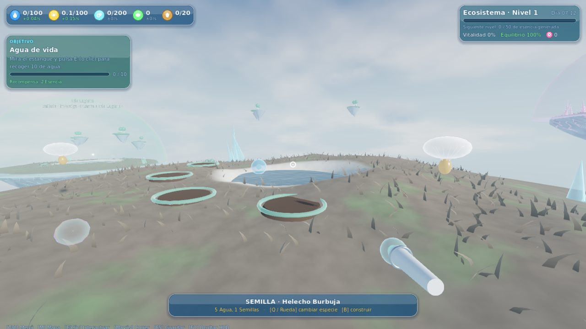
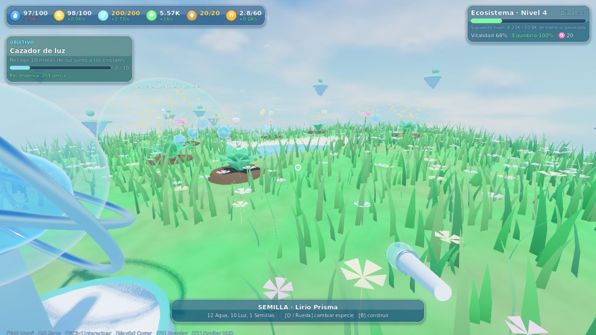
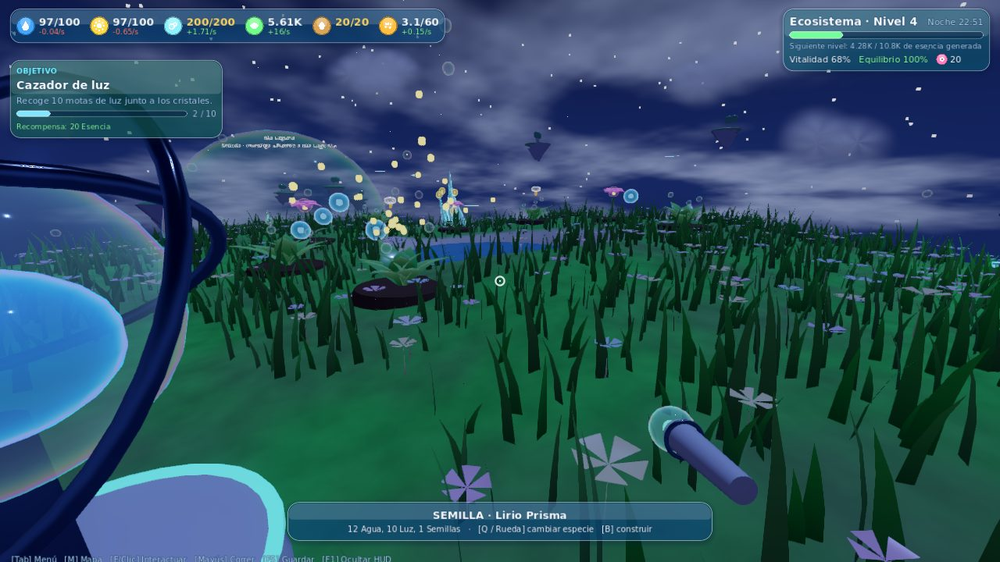
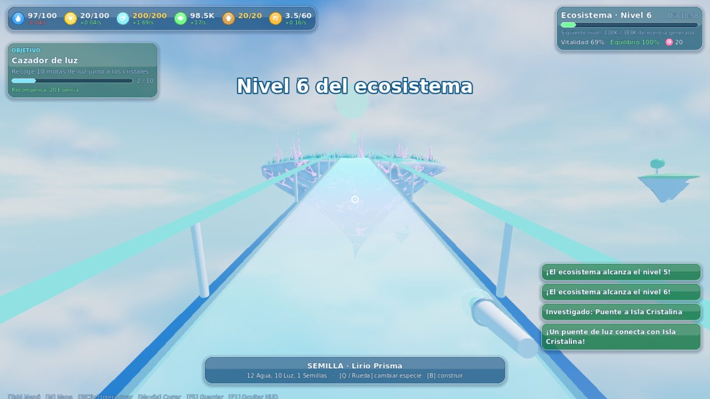
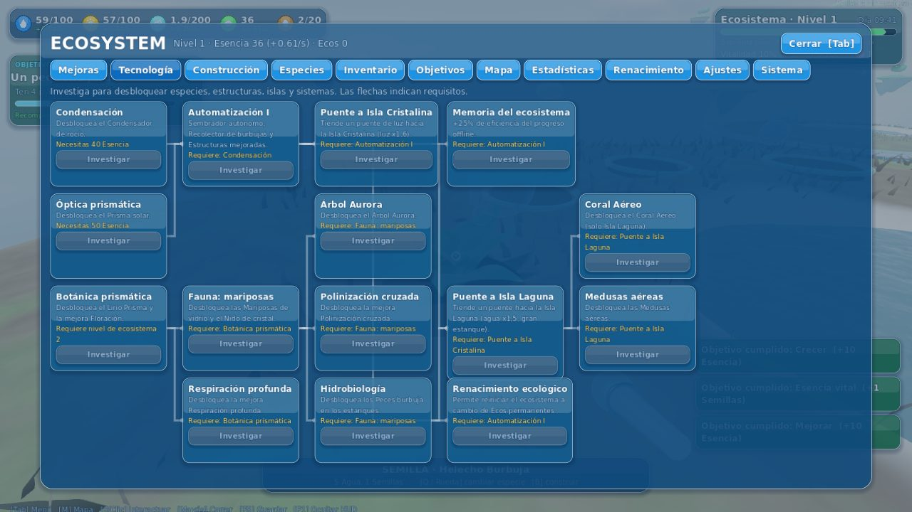
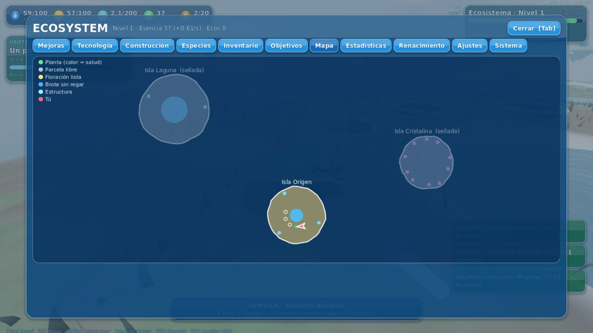

# ECOSYSTEM — juego incremental 3D (Godot 4)

Empiezas en una pequeña isla flotante, casi muerta, suspendida en un cielo infinito.
No recoges objetos para comprar mejoras sin más: **modificas las condiciones del mundo**
(agua, luz, oxígeno y biodiversidad) para que se formen cadenas de producción naturales.

```
Agua + Luz ──► Flora ──► Oxígeno + Esencia ──► Fauna ──► Polen / Perlas / Biodiversidad
   ▲              │                                         │
   └── estructuras, mejoras y tecnología ◄── multiplicadores ┘
```

Si el ecosistema pierde el equilibrio (sequía, penumbra, asfixia, sobrepoblación) las
plantas se marchitan, la fauna desaparece y la producción cae.

## Ejecutar

1. Instala **Godot 4.3** (o superior 4.x, edición estándar, sin .NET).
2. Abre `ecosystem/project.godot` en el editor y pulsa **F5**, o desde terminal:
   ```bash
   godot --path ecosystem
   ```

No hay dependencias externas: toda la geometría, los materiales, los iconos y el audio se
generan por código.

## Controles

| Tecla | Acción |
|---|---|
| WASD / flechas | Moverse · **Mayús** correr · **Espacio** saltar |
| Ratón | Mirar |
| **E** / clic izquierdo | Interactuar: recoger agua (mantener), extraer luz de cristales (mantener), recoger fenómenos, plantar, regar, cosechar floraciones |
| **Q** / rueda | Cambiar la especie de semilla |
| Mantener **X** | Arrancar planta / desmantelar estructura |
| **B** | Modo construcción (clic colocar, **R** rotar, rueda cambiar, clic derecho salir) |
| **Tab** / **I** | Menú (mejoras, tecnología, construcción, especies, inventario, objetivos, mapa, estadísticas, renacimiento, ajustes, sistema) |
| **M** | Mapa |
| **Esc** | Menú de sistema / salir del modo construcción |
| **F5 / F9** | Guardado / carga rápida · **F1** ocultar HUD |

## Primeros minutos

1. Mira el estanque y pulsa **E** para recoger agua.
2. Recoge una **semilla flotante** (hay dos cerca del punto de inicio).
3. Mira una **parcela fértil** (anillo brillante) y pulsa **E** para plantar un Helecho Burbuja.
4. **Riega** el brote (icono de gota).
5. Mantén agua y luz disponibles: la planta madura y produce **esencia** y **oxígeno** sola.
6. Abre el menú (**Tab**) y compra tu primera **mejora**.
7. Cosecha floraciones, investiga, construye condensadores y prismas, introduce fauna,
   expande la isla, cruza los puentes de luz… y renace para obtener **Ecos** permanentes.

El panel **OBJETIVO** guía todo el recorrido (23 misiones + misiones infinitas).

## Estructura del proyecto

```
ecosystem/
├── project.godot          Configuración (autoloads, render Forward+)
├── data/*.tres            Datos configurables: plantas, fauna, estructuras, mejoras,
│                          tecnologías, misiones e islas (editables en el inspector)
├── scenes/                main.tscn (mundo), player.tscn
├── shaders/               terreno, agua, cristal, hierba, planta, cielo, nubes, alas
├── scripts/
│   ├── autoload/          DB (datos), GameState (modelo), SaveManager, Audio
│   ├── core/              EcosystemSim (simulación pura), Economy, IslandLayout,
│   │                      NumFmt, InputSetup
│   ├── data/              Clases Resource de las definiciones
│   ├── world/             Vistas 3D: islas, plantas, estructuras, fenómenos, fauna,
│   │                      puentes, entorno (cielo/día-noche), mundo
│   ├── player/            Jugador en primera persona y modo construcción
│   └── ui/                Tema Aero, HUD, menú, mapa, iconos
├── tests/                 Pruebas headless de sistemas + piloto automático con render
└── docs/                  Diseño, economía y registro de fases
```

**Arquitectura modelo–vista.** `GameState` contiene todo el estado como datos planos
(diccionarios serializables) y `EcosystemSim.step()` lo hace avanzar sin depender de
nodos. Por eso el mismo código sirve para el juego en tiempo real, el progreso offline y
las pruebas. Las escenas 3D y la interfaz solo leen el estado y escuchan sus señales.
Detalles en [docs/ARQUITECTURA.md](docs/ARQUITECTURA.md).

## Pruebas

```bash
# Sistemas y economía (sin gráficos): 104 comprobaciones + simulación de balance de 40 min
godot --headless --path ecosystem res://tests/test_runner.tscn

# Partida completa automatizada con render real y capturas de pantalla
godot --path ecosystem -- --autotest --shots=/tmp/capturas --save=user://autotest.json
```

El piloto automático juega usando los mismos caminos de código que una persona (rayo de
interacción, tecla E, botones del menú, modo construcción) y verifica el primer objetivo:
moverse, recoger agua y semillas, plantar, regar, madurar, producir, comprar una mejora,
ver el cambio visual del ecosistema, cruzar a una isla nueva y guardar/cargar.

## Guardado

- `user://ecosystem_save.json` (con copia de seguridad `.bak.json`), ajustes en `user://settings.cfg`.
- Autoguardado configurable (15 s – 2 min) y al cerrar la ventana.
- Progreso offline configurable: activado/desactivado y máximo de 1 a 24 h; eficiencia
  base del 50 % (mejorable con tecnología y mejoras permanentes).

## Capturas

| Inicio: isla casi muerta | Ecosistema vivo |
|---|---|
|  |  |
| **Noche** | **Puente de luz a la Isla Cristalina** |
|  |  |
| **Árbol tecnológico** | **Mapa** |
|  |  |

(Capturas generadas por el piloto automático con renderizado por software.)
